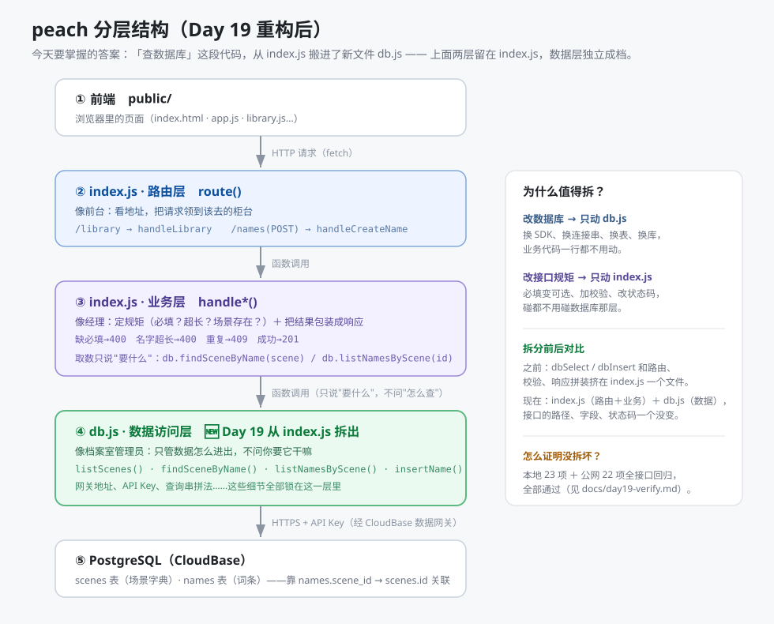

# day19-layering.md｜Day 19 分层说明（为什么拆、拆了什么、怎么证明没拆坏）

> 今天要掌握的问题：**拆完之后，「查数据库」这段代码从哪移到了哪？**
> 答案：从 `cloudfunctions/api/index.js` 移到了新文件 `cloudfunctions/api/db.js`。
> 路由层和业务层留在 index.js，数据层独立成档——接口的路径、字段、状态码一个都没变。



---

## 1. 三层各自管什么（一张表说清）

| 层 | 在哪个文件 | 管什么 | 明确不管什么 | 像谁 |
| --- | --- | --- | --- | --- |
| ② 路由层 | `index.js` 的 `route()` | 看地址，把请求领到该去的柜台（`/library` → handleLibrary） | 不做校验、不碰数据 | 前台 |
| ③ 业务层 | `index.js` 的 `handle*()` | 定规矩（必填？超长？场景存在？）＋ 决定状态码（400/409/201）＋ 包装响应 | 不知道网关地址、API Key 长什么样 | 经理 |
| ④ **数据层** | **`db.js`（Day 19 新拆）** | 只管数据怎么进出：网关地址、API Key、查询串拼法、错误翻译前的原始返回 | 不判断"这对不对"，不下业务结论 | 档案室管理员 |

（① 前端 `public/` 和 ⑤ PostgreSQL 是这条链的两端，今天都没动。）

## 2. 具体搬了哪些东西

| 东西 | 之前在哪 | 现在在哪 |
| --- | --- | --- |
| 网关地址拼接（`REST_BASE`） | index.js 顶部 | `db.js` 顶部 |
| API Key 读取（`API_KEY`） | index.js 顶部 | `db.js` 顶部 |
| 查询函数 `dbSelect(table, query)` | index.js | `db.js`（内部） |
| 写入函数 `dbInsert(table, row)` | index.js | `db.js`（内部，改名 `gwCall` 统一承载） |
| —— 新增：语义化取数函数 | ——（无） | `db.js` 对外只暴露 6 个"说人话"的函数 |

`db.js` 对外只暴露这 6 个函数（业务层**不再自己拼 REST 查询串**）：

```js
db.listScenes()              // 场景字典（按 sort_order 排好）
db.listSceneNames()          // 场景名列表（"场景不存在"报错时带上"有哪些可选"）
db.findSceneByName(name)     // 按场景名找场景 → 那一行 或 null
db.listNamesByScene(sceneId) // 某场景下所有词条（靠 names.scene_id → scenes.id）
db.findNameInScene(sceneId, name) // 写入后的"读回"双保险 → 那一行 或 null
db.insertName(row)           // 写入；原样交回 { status, body }，成败由业务层判断
```

**分层的边界线画在哪**：`db.js` 里没有一句"409""400"这样的 HTTP 话术；
`index.js` 里没有一句"select=""eq.""Bearer"这样的数据库话术。两边互相只说"人话"。

## 3. 为什么值得拆（分层最实在的回报）

| 以后要改什么 | 要动哪个文件 | 不用动哪个 |
| --- | --- | --- |
| 换一种方式连数据库（换 SDK / 换连接串 / 换库） | 只改 `db.js` | 业务层一行不动 |
| 换表名、改查询写法 | 只改 `db.js` | 同上 |
| 改接口规矩（必填变可选、加校验、改状态码） | 只改 `index.js` 业务层 | 不用碰数据库那层 |
| 第 4 周加 `/api/generate` 真模型接口 | `index.js` 加一个 handler（取数复用 `db.*`） | `db.js` 大概率不用动 |

打个比方：饭店把**前台**（迎宾领位）、**经理**（定规矩、拍板）和**采购**（知道去哪个市场、怎么讲价）分成三个岗位。
哪天换了个采购的进货渠道，前台和经理照常营业——这就是"分层"。

## 4. 怎么证明没拆坏（全接口回归）

| 轮次 | 项数 | 结果 |
| --- | --- | --- |
| 本地（函数直跑，真 Key） | 23 项 | ✅ 全过（`_d19_local_test.py`，记录见 `day19-verify.md`） |
| 公网（部署后真实请求） | 22 项 | ✅ 全过（读 7 + 写 11 + 方法校验 4，另含 SQL 计数闭环） |

回归覆盖：`/api/health`（version **1.3.0**）、`/api/scenes`（count 6）、`/api/library`（品牌 7 / 宠物 6 / 关键词"海" 1 / limit=2 截断 / limit=9999 夹到 100 / 场景不存在 400 带可选列表）、`POST /api/names`（成功 201 → 重复 409 → 缺必填 400 → 超长 400 → 场景不存在 400 → 坏 JSON 400 → 超 4KB 413 → GET/POST/PUT 405）。

## 5. 今天不做的

- ❌ 改接口路径和字段名（契约冻结，见 `api-contract.md` Day 19 变更记录）
- ❌ 加新功能（`/api/generate` 接真模型、PATCH/DELETE 都留给第 4 周）
- ✅ 前端 `public/` 一行没动；`db/` 表结构零改动
